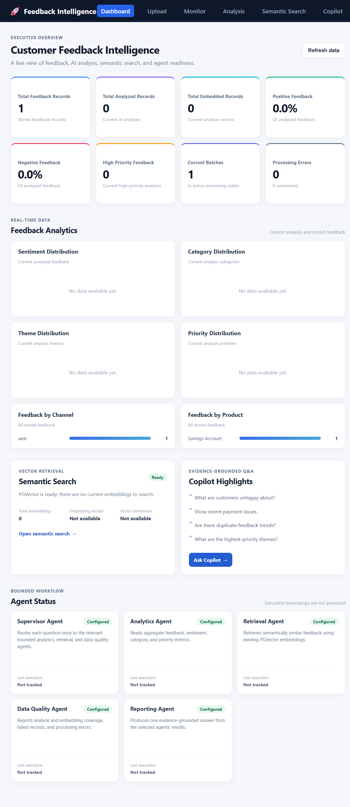

# Customer Feedback Intelligence Platform - Frontend (Angular)

The web frontend for the Customer Feedback Intelligence Platform, built using Angular 21, TypeScript, and SCSS.

> The frontend includes an executive dashboard, CSV ingestion/monitoring, AI analysis, semantic search, and the evidence-grounded Copilot, all backed by Spring Boot APIs.

---

## 1. Prerequisites

- Node.js 20+ (Installed: Node.js 24.15.0)
- npm 10+ (Installed: npm 11.12.1)
- Angular CLI 21+ (Installed: Angular CLI 21.2.9)

---

## 2. Installation & Setup (PowerShell on Windows)

```powershell
# Navigate to frontend-angular directory
cd D:\Projects\CustomerFeedbackIntelligence\frontend-angular

# Install dependencies (if setting up from fresh clone)
npm install
```

---

## 3. Configuration

Environment configurations are located in `src/environments/`:
- `src/environments/environment.development.ts` (Active during `ng serve` / development)
- `src/environments/environment.ts` (Active during production build)

Configuration keys:
- `apiBaseUrl`: Base endpoint for Spring Boot business API (`http://localhost:8080/api/v1`)
- `aiServiceBaseUrl`: Base endpoint for AI service (`http://localhost:8000`)
- `production`: Boolean flag indicating build environment

---

## 4. Development Server

```powershell
# Start Angular dev server on port 4200
npm start
# or: ng serve
```

Access the UI at: [http://localhost:4200](http://localhost:4200)

---

## 5. Executive Dashboard

The default `/` route redirects to `/dashboard`. The Executive Dashboard displays live feedback/analysis/embedding KPIs, sentiment percentages, active batches, processing errors, six distribution charts, vector-search status, and configured Phase 5 agent statuses. It loads current database data through:

- `GET /api/v1/dashboard`
- `GET /api/v1/dashboard/agents`

Charts use Angular templates and native CSS bars; no chart package or fixture data is used. If a data group is empty, the dashboard shows an empty state. Agent execution timestamps are not persisted and are labeled as not tracked.

## 6. AI Analysis

Open `/analysis` (also available from the main navigation) to run AI analysis for pending feedback in a batch, optionally limit the number of records, and inspect persisted results. Existing results can be loaded by batch ID and individual feedback can be re-analyzed.

The UI calls Spring Boot endpoints under `/api/v1/analysis`; Spring Boot invokes the FastAPI service for analysis runs. The Gemini API key and model configuration belong to the AI service and are not exposed to the browser.

## 7. Semantic Search

Open `/semantic-search` from the main navigation to search analyzed feedback by meaning. Results show similarity, feedback text, and current analysis labels. Expand the embedding section to generate missing embeddings for a batch of analyzed feedback.

## 8. Testing

```powershell
# Run unit tests
npm test -- --watch=false
```

---

## 9. Production Build

```powershell
# Build optimized production bundle
npm run build
```
Bundle output is generated in `dist/frontend-angular`.

## 10. Mentor Demo Flow

1. Start PostgreSQL, FastAPI, Spring Boot, and Angular using the root README instructions.
2. Open `/dashboard` and review live KPI cards and distribution charts.
3. Use the Semantic Search link to show retrieval status and matching feedback (when current embeddings exist).
4. Open Copilot, ask a sample question, and inspect its answer, agents, and supporting evidence.
5. Demonstrate Upload and Monitor to show where dashboard records originate.

### Dashboard Screenshots



The screenshot reflects the local database at capture time; chart panels without records show empty states rather than sample values.
